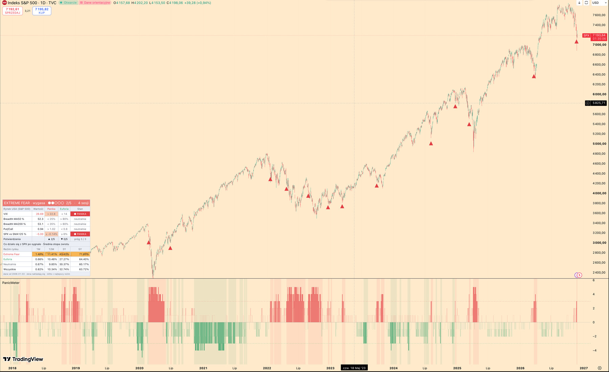

# Market Panic Meter

**Wskaźnik do TradingView, który mówi, czy na rynku USA panuje panika, i 20 lat testów, które sprawdzają, co z tą informacją zrobić.**

> Narzędzie edukacyjne, nie rekomendacja inwestycyjna. Wyniki historyczne nie gwarantują przyszłych.

---

## W skrócie

- Wskaźnik łączy **5 miar strachu**. Gdy co najmniej **3 naraz** pokazują panikę, włącza się stan **EXTREME FEAR**.
- Przetestowałem go na S&P 500 (z dywidendami) w latach **2006–2026**, w trzech scenariuszach.
- **Panika to dobry moment na zakup, ale czekanie na nią się nie opłaca.** Po sygnale rynek przez ~3 miesiące rośnie szybciej niż przeciętnie, jednak gotówka trzymana „na okazję” traci więcej, niż ta okazja daje.
- **Wniosek praktyczny:** inwestuj regularnie całość wpłat, nie sprzedawaj w panice ani w euforii, a wskaźnik traktuj jako hamulec emocji.

## Jak działa wskaźnik

Każda z pięciu miar głosuje: panika, euforia albo nic.

| Miara | Co mierzy | Panika | Euforia |
| --- | --- | --- | --- |
| **VIX** | oczekiwana zmienność, „indeks strachu” | > 22,8 | < 14 |
| **% spółek > SMA50** | ile spółek S&P 500 jest w krótkim trendzie wzrostowym | < 25% | > 80% |
| **% spółek > SMA200** | to samo dla długiego trendu | < 35% | > 80% |
| **Put/Call (CBOE)** | czy inwestorzy masowo kupują ochronę przed spadkami | > 1,02 | < 0,80 |
| **S&P 500 vs SMA125** | jak daleko emocje odsunęły cenę od trendu | ≤ −0,14% | ≥ +6% |

Jeden wskaźnik w odosobnieniu bywa fałszywym alarmem, dlatego stan rynku zmienia się dopiero przy **3 z 5** głosów. Progi VIX, Put/Call i SMA125 pochodzą z [analizy kanału Merytorycznie o Finansach](https://www.youtube.com/watch?v=og8nvMuqfD0). Progi szerokości rynku i euforii skalibrowałem sam.

**Co widać na wykresie:**
- **panel stanu:** odczyty, stan każdej miary, liczba potwierdzeń (np. `●●○○○ 2/5`) i informacja, ile sesji trwa reżim;
- **okno potwierdzeń:** czerwone pasmo w górę to panika, zielone w dół to euforia;
- **trójkąt ▲ pod świecą:** wejście w EXTREME FEAR (jeden na epizod);
- **tabela „Co działo się po sygnale”:** średnie przyszłe stopy zwrotu 1M / 12M / 3Y / 5Y dla każdego reżimu, liczone dla instrumentu z wykresu;
- **5 alertów:** wejście i wyjście z paniki, „brakuje 1 potwierdzenia”, wejście i wyjście z euforii.

Sygnał zawsze opisuje **cały rynek USA**, także na wykresie NVDA czy WIG20. Działa na interwałach intraday, 1D, 1W i 1M, a statystyki liczy na 1D, 1W i 1M.

## Co pokazały testy

Testy liczone na **S&P 500 Total Return (SPXTR)**, 2006–2026, z prowizją 0,1% i zleceniami na otwarciu następnej sesji. Szczegóły w [wynikach testów](docs/wyniki-testow.md).

**1. Po panice rynek rośnie szybciej, ale tylko przez kilka miesięcy.**
Zakup przy EXTREME FEAR i trzymanie przez 63 sesje (~3 miesiące) dało **15,7% rocznie** w czasie trzymania akcji, wobec **10,8%** dla „kup i trzymaj”, przy dwa razy mniejszym obsunięciu (−35% zamiast −55%). Ten sam wynik wyszedł na SPX, SPY i SPXTR. Przy trzymaniu przez rok lub 3 lata przewaga znika.

**2. Czekanie na panikę z gotówką przegrywa.**
Odkładanie 10–30% miesięcznych wpłat na „okazję w panice” dało **od 0,3% do 1,6% mniej** niż zwykłe regularne inwestowanie. Wynik był taki sam w każdym wariancie i w obu dekadach. Rezerwa nie zmniejszyła też obsunięcia.

**3. Sprzedawanie w euforii szkodzi.**
Wyjście z rynku przy euforii i powrót po jej końcu dało **+485%** wobec **+743%** dla „kup i trzymaj”. Okresy euforii mają w danych wysoki win rate i dobry stosunek zysku do ryzyka.

**4. Ostrzejszy filtr nie pomaga.**
Wymóg 4 potwierdzeń zamiast 3 obniżył wynik z 15,7% do 8,1% rocznie, bo sygnał przychodzi po najmocniejszych dniach odbicia.

## Jak to wykorzystać

1. **Rdzeń:** regularne wpłaty, 100% od razu w szeroki indeks.
2. **Panika (EXTREME FEAR):** nie sprzedawaj. Jeśli akurat masz dodatkowe pieniądze, to dobry moment, żeby je zainwestować od razu.
3. **Euforia:** też nie sprzedawaj.
4. **Nie trzymaj gotówki „na krach”.** Testy pokazują, że to kosztuje więcej, niż daje.
5. **Dopasuj do siebie.** Jeśli spadek portfela o 35–55% mógłby skłonić Cię do sprzedaży, zmniejsz udział akcji, zamiast próbować wyczuć moment.

## Pliki

| Plik | Do czego |
| --- | --- |
| [`scripts/panic_meter.pine`](scripts/panic_meter.pine) | wskaźnik do codziennego użycia |
| [`scripts/panic_meter_tests.pine`](scripts/panic_meter_tests.pine) | test zbiorczy: wszystkie warianty A, B, C w jednej tabeli |
| [`docs/wyniki-testow.md`](docs/wyniki-testow.md) | pełne wyniki, liczby i ograniczenia |
| [`docs/jak-testowac.md`](docs/jak-testowac.md) | jak samodzielnie powtórzyć testy w TradingView |

## Instalacja

1. Otwórz wykres **SP:SPX** albo **SP:SPXTR**, interwał **1D**.
2. **Pine Editor** → **Utwórz nowy** → **Wskaźnik**, wklej kod, **Zapisz**, **Dodaj do wykresu**.
3. Alerty: prawy klik na wskaźniku → **Dodaj alert** → wybierz warunek.

Wszystkie progi zmienisz w ustawieniach wskaźnika.

## Ograniczenia

- **Mała próba:** od 2006 r. było kilkanaście niezależnych epizodów paniki, a przewagę budują głównie duże odbicia (2009, 2020, 2022, 2025).
- **Jeden rynek i dobry okres:** USA w latach 2006–2026. WIG20 w tym czasie prawie stał w miejscu, więc wniosków z S&P 500 nie należy przenosić na GPW jeden do jednego.
- **Put/Call po 2020 r.** jest strukturalnie niższy, więc próg 1,02 wybija rzadziej niż kiedyś.
- **Rezerwa w testach nie dostaje odsetek.** Przy 2–4% różnica byłaby mniejsza, ale raczej nie zmieniłaby znaku.

## Licencja

[Mozilla Public License 2.0](https://mozilla.org/MPL/2.0/).

---

### English summary (for the TradingView library)

**Market Panic Meter** flags *Extreme Fear* and *Euphoria* on the US market by voting across five gauges: VIX, % of S&P 500 stocks above their 50- and 200-day MAs, CBOE total put/call ratio, and the S&P 500's distance from its 125-day SMA. *Extreme Fear* needs 3 of 5 confirmations. The script includes a status panel, regime markers, a forward-returns table (1M/12M/3Y/5Y) and alerts. Daily data without lookahead, so closed bars do not repaint. Backtests on SPXTR 2006–2026: buying panic and holding ~3 months beat the market per year invested (15.7% vs 10.8%), but holding cash in reserve for panics underperformed plain dollar-cost averaging, and selling in euphoria hurt returns. Educational tool, not investment advice.
