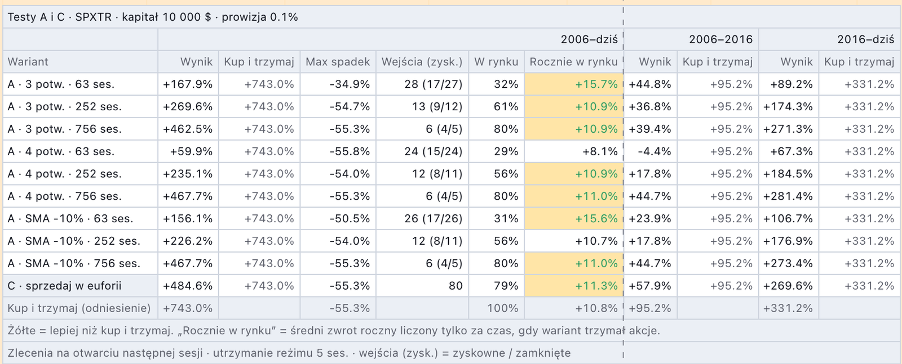
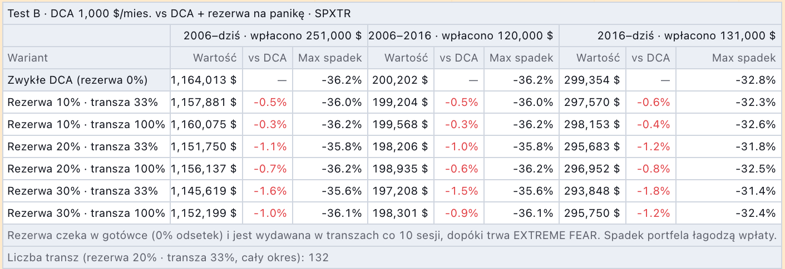

# Wyniki testów

**Krótka wersja:** sygnał paniki ma realną, ale krótką przewagę. Opłaca się nie sprzedawać w panice i kupować za pieniądze, które akurat masz. Nie opłaca się czekać na panikę z gotówką ani sprzedawać w euforii.

Wszystkie liczby poniżej pochodzą z [`scripts/panic_meter_tests.pine`](../scripts/panic_meter_tests.pine), uruchomionego na **S&P 500 Total Return (SPXTR), 1D**. Ustawienia:
- okres **2006-01-01 – 2026-11-24** oraz osobno dwie dekady: 2006–2016 i 2016–dziś;
- prowizja 0,1%, zlecenia na **otwarciu następnej sesji** (bez zaglądania w przyszłość);
- sygnał z domyślnymi progami wskaźnika, reżim utrzymywany 5 sesji po zaniku.

---

## Punkt wyjścia: co działo się po sygnale

Wbudowana tabela wskaźnika (S&P 500, 2006–2026) pokazuje średnią stopę zwrotu po każdej sesji w danym reżimie:

| Reżim | 1M | 12M | 3Y | 5Y |
| --- | --- | --- | --- | --- |
| **Extreme Fear** | **+1,40%** | **+11,41%** | **+43,43%** | **+71,63%** |
| Euforia | +0,66% | +10,48% | +27,27% | +64,40% |
| Neutralnie | +0,67% | +9,85% | +30,37% | +60,17% |
| Wszystkie sesje | +0,82% | +10,34% | +32,74% | +63,72% |

To zgadza się z oryginalną analizą (5Y: 76,7% po panice wobec 66,0% w okresach neutralnych). Pytanie brzmi: czy da się na tym zarobić? Odpowiadają na to trzy testy.

---

## Test A · Kupuj panikę, potem trzymaj

**Zasada:** cały kapitał w gotówce, zakup przy wejściu w EXTREME FEAR, sprzedaż po N sesjach.

| Wariant | Wynik 2006–dziś | Czas w rynku | Rocznie w rynku | Max spadek |
| --- | --- | --- | --- | --- |
| **3 potwierdzenia · 63 sesje** | +168% | 32% | **15,7%** | **−34,9%** |
| 3 potwierdzenia · 252 sesje | +270% | 61% | 10,9% | −54,7% |
| 3 potwierdzenia · 756 sesji | +463% | 80% | 10,9% | −55,3% |
| 4 potwierdzenia · 63 sesje | +60% | 29% | 8,1% | −55,8% |
| Kup i trzymaj | **+743%** | 100% | 10,8% | −55,3% |

**Co z tego wynika**
- W liczbach bezwzględnych **żaden wariant nie pokonuje „kup i trzymaj”**, w żadnym okresie, bo strategia przez większość czasu trzyma gotówkę.
- W przeliczeniu na rok w rynku wyraźna przewaga jest **tylko przy krótkim trzymaniu (~3 miesiące)**: 15,7% wobec 10,8%, przy dwa razy mniejszym obsunięciu. Ten sam wynik wyszedł na SPX (13,3%) i SPY (15,3%).
- Przy dłuższym trzymaniu wynik jest **równy rynkowi**. Odbicie po panice trwa kilka miesięcy, potem działa już zwykły wzrost.
- **Więcej potwierdzeń = gorzej.** Przy 4 z 5 sygnał przychodzi po najmocniejszych dniach odbicia.
- **Próg SMA nie ma znaczenia:** −0,14% i −10% dają prawie to samo (15,7% i 15,6%).

---

## Test B · Regularne wpłaty z rezerwą na panikę

**Zasada:** 1000 $ co miesiąc. Zwykłe DCA inwestuje całość od razu. Wersja z rezerwą odkłada 10–30% w gotówce i wydaje ją w transzach co 10 sesji, dopóki trwa EXTREME FEAR.

| Wariant | 2006–dziś | 2006–2016 | 2016–dziś |
| --- | --- | --- | --- |
| Zwykłe DCA (wpłacono 251 000 $) | **1 164 013 $** | 200 202 $ | 299 354 $ |
| Rezerwa 10% | −0,3% do −0,5% | −0,3% do −0,5% | −0,4% do −0,6% |
| Rezerwa 20% | −0,7% do −1,1% | −0,6% do −1,0% | −0,8% do −1,2% |
| Rezerwa 30% | −1,0% do −1,6% | −0,9% do −1,5% | −1,2% do −1,8% |

**Co z tego wynika**
- **Każdy wariant z rezerwą przegrywa** ze zwykłym DCA, w obu dekadach. Im większa rezerwa, tym większa strata.
- Obsunięcie portfela praktycznie się nie zmienia (−35,6% do −36,2% wobec −36,2%).
- To nie kwestia rzadkich sygnałów: przy 20% rezerwy było **132 transze**. Przewaga z odbicia po panice jest po prostu mniejsza niż koszt trzymania gotówki, gdy rynek rośnie.

---

## Test C · Kup i trzymaj, ale sprzedaj w euforii

**Zasada:** cały czas w rynku, sprzedaż przy wejściu w EUFORIĘ, powrót po jej końcu.

| | Wynik 2006–dziś | Czas w rynku | Max spadek |
| --- | --- | --- | --- |
| Sprzedaż w euforii | +485% | 79% | −55,3% |
| Kup i trzymaj | **+743%** | 100% | −55,3% |

**Co z tego wynika:** 80 sprzedaży i 21% czasu poza rynkiem kosztowało ponad 250 punktów procentowych zysku, bez żadnej ochrony przed spadkami. Euforia nie jest sygnałem sprzedaży.

---

## Wnioski dla strategii

| Pytanie | Odpowiedź z testów |
| --- | --- |
| Sprzedawać, gdy jest panika? | **Nie.** Kolejne miesiące są statystycznie lepsze niż przeciętne. |
| Kupować, gdy jest panika? | **Tak, jeśli masz wolne pieniądze.** Przez ~3 miesiące rynek rośnie szybciej niż zwykle. |
| Trzymać gotówkę na panikę? | **Nie.** −0,3% do −1,6% względem zwykłego DCA. |
| Sprzedawać w euforii? | **Nie.** +485% wobec +743%. |
| Zaostrzyć sygnał (4 z 5)? | **Nie.** Przychodzi za późno. |

## Ograniczenia

- **Mała liczba niezależnych zdarzeń:** 28 wejść w teście A, a wynik napędzają głównie 2009, 2020, 2022 i 2025.
- **Nakładające się okna** w tabeli wskaźnika: kolejne sesje tej samej paniki dają podobny wynik, więc to statystyka opisowa, nie test istotności.
- **Gotówka bez odsetek** w testach A i B. Przy realnych 2–4% różnice byłyby mniejsze.
- **Jeden rynek, jeden okres:** wyniki dotyczą USA w latach 2006–2026.
- **Podatki i kursy walut** nie są uwzględnione.
